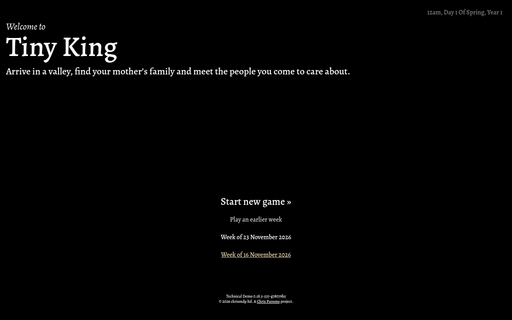

Built on branch `old-worlds`, based on `78079b5`. The affected Jest gate passed 55 tests across 8 files. The frozen production play test passed 25 checks with 0 failures.

| Area | Change |
| --- | --- |
| Storage | Worlds use `v<SAVE_VERSION>/<YYYY>-W<ww>.json.gz`. Builds overwrite that week's key and never delete older keys. |
| Worker | `/worlds` lists every R2 page for the current save version, filters invalid keys and sorts newest first. Each entry contains `id` and `monday`. |
| Downloads | `/worlds/current.json.gz` streams the newest stored week. Explicit weeks stream directly. Missing worlds return 404. |
| Caching | Current downloads and listings cache for 60 seconds. Explicit past weeks cache for 31,536,000 seconds. Missing downloads use `no-store`. |
| Deployment | Both UTC schedules run through a London midnight gate. All later steps skip successfully outside Monday 00:00–00:59. Push and manual runs always continue. |
| Upload | `build-world` prints the week and writes the week, key and file to GitHub step outputs. The workflow uploads with pinned Wrangler 4.156.0 before deployment. |
| Menu | Start new game downloads the newest stored world. The quieter earlier-week picker shows all stored weeks, newest first, when at least two exist. |
| Local development | The dev server uses the Worker routes with a folder as its bucket. The frozen Python server serves the same three routes from `worlds/`. |

The save version moved into a small shared module. Existing imports from `save_game` still work. The value remains `1`. Week seeds keep their existing UTC API. The build uses London's calendar date to choose its week and seed, including summer Sunday at 23:00 UTC.

`npm run build-world -- --seed 13` wrote `worlds/v1/2026-W48.json.gz`. `worlds/` is gitignored. The production build contains no `dist/world.json.gz`. The clean-plugin exception was removed. Explicit `?seed=<n>` still takes the existing browser generation branch.

The screenshot uses a local folder with two week keys. `2026-W48` contains the real pre-built seed 13 world. `2026-W47` is an explicitly created fixture containing the same bytes. It does not represent recovered historical data.



The preview selected “Week of 16 November 2026”, downloaded `/worlds/2026-W47.json.gz` and started a seed 13 game. It did not download `/worlds/current.json.gz`. The browser reported no page errors. The preview ran on port 8192. Its [receipt](old-worlds/menu-preview.txt) and [script](old-worlds/observe-menu.cjs) are included.

Every menu string written or reused in an edited line:

- `Start new game` (existing text, unchanged).
- `Play an earlier week`.
- `Loading earlier weeks…`.
- `Could not load earlier weeks. Please try again.`
- `Week of <day> <English month> <year>`, with no leading zero on the day.
- `Week of 23 November 2026` and `Week of 16 November 2026` in the two-week fixture.

The download screen also changed these player-facing strings: `Downloading your world`, `Unpacking your world`, and `Could not download your world (HTTP <status>). Please try again.`

The tests were written first. The initial red run found the old download URL and missing new modules. Its complete literal output follows.

Command:

```sh
flock -w 7200 /tmp/27agents-gate.lock npx jest --runInBand --runTestsByPath test/worlds_worker.test.js test/london_midnight.test.js test/world_menu.test.js test/world_loader.test.js
```

Exit 1. Literal output:

```text
FAIL test/worlds_worker.test.js
  ● Test suite failed to run

    Cannot find module '../src/worker' from 'test/worlds_worker.test.js'

      1 | /* global it, expect, jest */
    > 2 | import worker from "../src/worker";
        | ^
      3 | import { WORLD_PREFIX, parseWorldKey, parseWorldWeek, worldKey, worldWeek } from "game/world_weeks";
      4 |
      5 | const request = path => new Request("https://tinyking.test" + path);

      at Resolver._throwModNotFoundError (node_modules/jest-resolve/build/index.js:1031:11)
      at Object.<anonymous> (test/worlds_worker.test.js:2:1)

FAIL test/world_loader.test.js
  ● downloads and restores the gzip save with progress (length known: true)

    expect(jest.fn()).toHaveBeenCalledWith(...expected)

    - Expected
    + Received

    - "/worlds/current.json.gz",
    + "world.json.gz",
      {"cache": "no-cache"},

    Number of calls: 1

      18 |   const updates = [];
      19 |   const loaded = await loadWorldTemplate(async (label, value) => updates.push({ label, value }), fetchWorld);
    > 20 |   expect(fetchWorld).toHaveBeenCalledWith("/worlds/current.json.gz", { cache: "no-cache" });
         |                      ^
      21 |   expect(loaded).toMatchObject(fixture);
      22 |   expect(loaded.ui.playerId).toBeUndefined();
      23 |   expect(updates.some(u => /Downloading/.test(u.label))).toBe(true);

      at test/world_loader.test.js:20:22

  ● downloads and restores the gzip save with progress (length known: false)

    expect(jest.fn()).toHaveBeenCalledWith(...expected)

    - Expected
    + Received

    - "/worlds/current.json.gz",
    + "world.json.gz",
      {"cache": "no-cache"},

    Number of calls: 1

      18 |   const updates = [];
      19 |   const loaded = await loadWorldTemplate(async (label, value) => updates.push({ label, value }), fetchWorld);
    > 20 |   expect(fetchWorld).toHaveBeenCalledWith("/worlds/current.json.gz", { cache: "no-cache" });
         |                      ^
      21 |   expect(loaded).toMatchObject(fixture);
      22 |   expect(loaded.ui.playerId).toBeUndefined();
      23 |   expect(updates.some(u => /Downloading/.test(u.label))).toBe(true);

      at test/world_loader.test.js:20:22

  ● downloads the week selected in the menu

    expect(jest.fn()).toHaveBeenCalledWith(...expected)

    - Expected
    + Received

    - "/worlds/2026-W47.json.gz",
    + "world.json.gz",
      {"cache": "no-cache"},

    Number of calls: 1

      30 |   const fetchWorld = jest.fn().mockResolvedValue(await download());
      31 |   expect(await loadWorldTemplate(async () => {}, fetchWorld, "2026-W47")).toMatchObject(fixture);
    > 32 |   expect(fetchWorld).toHaveBeenCalledWith("/worlds/2026-W47.json.gz", { cache: "no-cache" });
         |                      ^
      33 | });
      34 |
      35 | it("rejects an HTTP failure before trying to unpack it", async () => {

      at Object.<anonymous> (test/world_loader.test.js:32:22)

FAIL test/world_menu.test.js
  ● Test suite failed to run

    Configuration error:

    Could not locate module game/world_menu mapped as:
    /home/cp/code/tk-worlds/src/game/$1.

    Please check your configuration for these entries:
    {
      "moduleNameMapper": {
        "/game\/(.*)/": "/home/cp/code/tk-worlds/src/game/$1"
      },
      "resolver": undefined
    }

      1 | /* global it, expect, jest */
    > 2 | import { weekChoices, loadWeekChoices } from "game/world_menu";
        | ^
      3 |
      4 | it("omits the earlier-week option with zero or one distinct stored week", () => {
      5 |   expect(weekChoices([])).toEqual([]);

      at createNoMappedModuleFoundError (node_modules/jest-resolve/build/index.js:1322:17)
      at Object.<anonymous> (test/world_menu.test.js:2:1)

FAIL test/london_midnight.test.js
  ● Test suite failed to run

    Cannot find module '../scripts/london-midnight' from 'test/london_midnight.test.js'

      1 | /* global it, expect */
    > 2 | const { shouldDeploy } = require("../scripts/london-midnight");
        |                          ^
      3 |
      4 | it.each([
      5 |   ["2026-11-29T23:00:00Z", false],

      at Resolver._throwModNotFoundError (node_modules/jest-resolve/build/index.js:1031:11)
      at Object.<anonymous> (test/london_midnight.test.js:2:26)

Test Suites: 4 failed, 4 total
Tests:       3 failed, 2 passed, 5 total
Snapshots:   0 total
Time:        1.17 s
Ran all test suites within paths "test/worlds_worker.test.js", "test/london_midnight.test.js", "test/world_menu.test.js", "test/world_loader.test.js".
```

After implementation, the same focused logic gate passed.

Command:

```sh
flock -w 7200 /tmp/27agents-gate.lock npx jest --runInBand --runTestsByPath test/worlds_worker.test.js test/london_midnight.test.js test/world_menu.test.js test/world_loader.test.js
```

Exit 0. Literal output:

```text

Test Suites: 4 passed, 4 total
Tests:       34 passed, 34 total
Snapshots:   0 total
Time:        0.943 s, estimated 1 s
Ran all test suites within paths "test/worlds_worker.test.js", "test/london_midnight.test.js", "test/world_menu.test.js", "test/world_loader.test.js".
```

The final affected gate added week-seed, save-format, template and first-game checks. No whole suite ran. No module-graph exception was required.

Command:

```sh
flock -w 7200 /tmp/27agents-gate.lock npx jest --runInBand --runTestsByPath test/worlds_worker.test.js test/london_midnight.test.js test/world_menu.test.js test/world_loader.test.js test/world_seed.test.js test/save_game.test.js test/world_template.test.js test/first_run.test.js
```

Exit 0. Literal output:

```text

Test Suites: 8 passed, 8 total
Tests:       55 passed, 55 total
Snapshots:   0 total
Time:        69.387 s
Ran all test suites within paths "test/worlds_worker.test.js", "test/london_midnight.test.js", "test/world_menu.test.js", "test/world_loader.test.js", "test/world_seed.test.js", "test/save_game.test.js", "test/world_template.test.js", "test/first_run.test.js".
```

The Worker tests use a fake R2 binding. They cover pagination, version filtering, canonical ISO week parsing, newest selection, streaming, cache lifetimes and 404s. The schedule tests cover winter, summer, both clock-change weekends and minute boundaries. The menu data tests cover zero, one and multiple weeks, duplicate IDs, sorting and Monday labels. No test asserts menu appearance.

Two existing checks changed. `test/world_loader.test.js` now expects the current endpoint and adds a selected-week download case. `scripts/playtest.js` now requires the exact `/worlds/current.json.gz` resource URL. Other assertions remain unchanged.

This repository has no TypeScript configuration or typecheck script. ESLint checked every changed JavaScript source and build configuration file. It exited 0 with empty output:

```sh
npx eslint src/worker.js src/game/save_version.js src/game/save_game.js src/game/world_weeks.js src/game/world_menu.js src/game/world_loader.js src/components/main_menu.js src/components/world.js scripts/build-world.js scripts/london-midnight.js scripts/serve-worlds.js scripts/playtest.js webpack.common.js webpack.dev.js
```

`node --check` passed for `scripts/london-midnight.js`, `scripts/build-world.js` and `scripts/serve-worlds.js`. Each command produced no output. Python AST parsing passed and printed `Python syntax OK`. `git diff --check` passed for source changes with empty output. Literal terminal transcripts retain their original whitespace.

Command:

```sh
npm run build-world -- --seed 13
```

Exit 0. Literal output:

```text

> tinyking@1.0.0 build-world
> node scripts/build-world.js --seed 13

Building world 2026-W48 for seed 13
{"week":"2026-W48","key":"v1/2026-W48.json.gz","seed":13,"out":"/home/cp/code/tk-worlds/worlds/v1/2026-W48.json.gz","seconds":133.213,"compressedBytes":4552476,"MiB":4.342}
```

Command:

```sh
flock -w 7200 /tmp/27agents-gate-2.lock npm run build
```

Exit 0. Literal output:

```text

> tinyking@1.0.0 build
> webpack --config webpack.prod.js

app:
  assets by path *.js 3.62 MiB
    asset app.6e9f464b9629e5505f40.js 2.68 MiB [emitted] [immutable] [minimized] [big] (name: app) 1 related asset
    asset vendors.67f5ab9c200a0caba974.js 962 KiB [emitted] [immutable] [minimized] [big] (name: vendors) (id hint: vendor) 2 related assets
    asset runtime.42ef496b93112205a055.js 1.58 KiB [emitted] [immutable] [minimized] (name: runtime) 1 related asset
  asset index.html 479 bytes [emitted] [minimized]
  asset COMMITHASH 40 bytes [emitted]
  asset LASTCOMMITDATETIME 25 bytes [emitted]
  asset VERSION 19 bytes [emitted]
  Entrypoint app [big] 3.62 MiB (7.63 MiB) = runtime.42ef496b93112205a055.js 1.58 KiB vendors.67f5ab9c200a0caba974.js 962 KiB app.6e9f464b9629e5505f40.js 2.68 MiB 3 auxiliary assets
  orphan modules 481 KiB [orphan] 140 modules
  runtime modules 3.9 KiB 9 modules
  javascript modules 5.29 MiB
    modules by path ./node_modules/ 3.82 MiB 123 modules
    modules by path ./src/ 1.46 MiB
      modules by path ./src/game/*.js 959 KiB 99 modules
      modules by path ./src/components/*.js 84.7 KiB 7 modules
      ./src/index.js + 66 modules 326 KiB [built] [code generated]
      ./node_modules/css-loader/dist/cjs.js!./node_modules/sass-loader/dist/cjs/index.js!./src/style.scss 128 KiB [built] [code generated]
  json modules 1.83 MiB
    ./src/data/event_types.json 16.4 KiB [built] [code generated]
    ./src/data/crops.json 80 bytes [built] [code generated]
    ./src/data/secret_activities.json 1.01 KiB [built] [code generated]
    ./src/data/conversation_lines.json 1.81 MiB [built] [code generated]

  WARNING in asset size limit: The following asset(s) exceed the recommended size limit (244 KiB).
  This can impact web performance.
  Assets: 
    app.6e9f464b9629e5505f40.js (2.68 MiB)
      Largest modules: ./src/data/conversation_lines.json (1.81 MiB), ./src/index.js + 66 modules (326 KiB), ./node_modules/css-loader/dist/cjs.js!./node_modules/sass-loader/dist/cjs/index.js!./src/style.scss (128 KiB)
    vendors.67f5ab9c200a0caba974.js (962 KiB)
      Largest modules: ./node_modules/three/build/three.core.js (1.39 MiB), ./node_modules/@fortawesome/free-solid-svg-icons/index.es.js (696 KiB), ./node_modules/three/build/three.module.js (647 KiB)

  WARNING in entrypoint size limit: The following entrypoint(s) combined asset size exceeds the recommended limit (244 KiB). This can impact web performance.
  Entrypoints:
    app (3.62 MiB)
        runtime.42ef496b93112205a055.js
        vendors.67f5ab9c200a0caba974.js
        app.6e9f464b9629e5505f40.js

  WARNING in webpack performance recommendations: 
  You can limit the size of your bundles by using import() or require.ensure to lazy load some parts of your application.
  For more info visit https://webpack.js.org/guides/code-splitting/

  app (webpack 5.112.2) compiled with 3 warnings in 32769 ms

save-worker:
  asset save-worker.js 11.9 KiB [emitted] [minimized] (name: main) 1 related asset
  orphan modules 58.2 KiB [orphan] 14 modules
  ./src/game/save_worker.js + 11 modules 60.6 KiB [built] [code generated]
  save-worker (webpack 5.112.2) compiled successfully in 855 ms
```

The finished source stayed frozen through browser acceptance. [Artifact hashes](old-worlds/frozen-artifact.sha256) identify the compiled JavaScript files. The frozen server ran this command:

```sh
python3 scripts/serve-frozen.py dist --port 8193
```

The installed Chromium is revision 1255. `CHROME` selected that executable. Browser temporary files and configuration stayed in the worktree.

Command:

```sh
CHROME=/home/cp/.cache/ms-playwright/chromium-1255/chrome-linux64/chrome TMPDIR="$PWD/.cache/tmp" XDG_CACHE_HOME="$PWD/.cache" XDG_CONFIG_HOME="$PWD/.cache/config" PLAYTEST_OUT="$PWD/shots/old-worlds/playtest" flock -w 7200 /tmp/27agents-gate.lock npm run playtest -- http://127.0.0.1:8193/
```

Exit 0. Literal output:

```text

> tinyking@1.0.0 playtest
> node scripts/playtest.js http://127.0.0.1:8193/

STARTUP menu ready after 0.26 seconds
STARTUP character/world ready after 4.336 seconds
STARTUP click Start new game to standing: 11.906 seconds (includes character screen and arrival)
PASS new games use the pre-built seed 13 world
PASS the arrival starts without camp, walks two hexes, makes camp and hands over standing in 4–6 seconds - {"seconds":5.278099999904634,"noCamp":true,"steps":2,"walked":true,"nearCamp":true,"standing":true,"bundle":true,"locked":true,"gameDays":0}
PASS the player starts at a camp with a bedroll and no house
PASS a waiting build is replaced by explicit chopping and finishes on a new build order
STARTUP menu ready after 4.583 seconds
STARTUP character/world ready after 4.078 seconds
PASS clicking a villager selects it - {"selected":"terrain5_3-person-4145"}
PASS clicking a tile opens its job menu, and Move here starts an order - {"target":"terrain5_3-828"}
PASS the current order appears in the status strip
PASS Chat starts a personal order from the person panel - {"person":"w5_3-social-74"}
PASS the person panel has no Recruit order
PASS Create Field, Create Stockpile and Cut down can be ordered from the popups - {"fieldTile":"terrain5_3-784","stockpileTile":"terrain5_3-695","tree":"terrain5_3-2407"}
PASS the player walks to the ordered tile - {"walker":"terrain5_3-person-4145","from":124,"to":4}
PASS the completed task leaves the panel
CHAT approach w5_3-social-74
CHAT panel open w5_3-social-74
CHAT line player.direct_answer.fallback_answer_wellbeing.base.01
PASS Chat pauses the world, chosen lines make contact and End chat releases the panel - {"person":"w5_3-social-74","lines":[{"id":"player.direct_answer.fallback_answer_wellbeing.base.01","family":"direct_answer","disabled":false,"matches":1,"score":0}],"pops":[{"kind":"topic","key":"season","score":1,"amount":1,"listenerId":"w5_3-social-74"}],"contact":{"day":0.4937499999999996,"position":{"x":2110.6358761346396,"y":667.4357592764001},"otherPosition":{"x":2160,"y":623.5382907247957}}}
PASS Gift chooser queues a real item for delivery
PASS the player walks over and gives the gift - {"itemId":"terrain5_3-4271","type":"wood","owner":"w5_3-social-96","personId":"w5_3-social-96","distance":5.415459315359215,"receiptDay":0.6479166666666657,"observedDay":0.6486111111111101}
SIMULATION observation 1/12 {"day":0.6722222222222212,"speed":"normal","worldBusy":false,"chatActive":false,"seasonTurn":false,"simulationClock":{"hour":0.00555555555555541,"requestsStarted":true,"winter":false,"frames":0.9419999999993891}}
SIMULATION observation 2/12 {"day":0.6930555555555544,"speed":"normal","worldBusy":false,"chatActive":false,"seasonTurn":false,"simulationClock":{"hour":0.02638888888888875,"requestsStarted":true,"winter":false,"frames":0.9419999999993891}}
SIMULATION observation 3/12 {"day":0.7138888888888877,"speed":"normal","worldBusy":false,"chatActive":false,"seasonTurn":false,"simulationClock":{"hour":0.005555555555555389,"requestsStarted":true,"winter":false,"frames":0.9419999999993891}}
SIMULATION observation 4/12 {"day":0.7347222222222209,"speed":"normal","worldBusy":false,"chatActive":false,"seasonTurn":false,"simulationClock":{"hour":0.02638888888888873,"requestsStarted":true,"winter":false,"frames":0.9419999999993891}}
SIMULATION observation 5/12 {"day":0.7555555555555542,"speed":"normal","worldBusy":false,"chatActive":false,"seasonTurn":false,"simulationClock":{"hour":0.005555555555555368,"requestsStarted":true,"winter":false,"frames":0.9419999999993891}}
SIMULATION observation 6/12 {"day":0.7763888888888875,"speed":"normal","worldBusy":false,"chatActive":false,"seasonTurn":false,"simulationClock":{"hour":0.02638888888888871,"requestsStarted":true,"winter":false,"frames":0.9419999999993891}}
SIMULATION observation 7/12 {"day":0.7972222222222207,"speed":"normal","worldBusy":false,"chatActive":false,"seasonTurn":false,"simulationClock":{"hour":0.005555555555555348,"requestsStarted":true,"winter":false,"frames":0.9419999999993891}}
SIMULATION observation 8/12 {"day":0.818055555555554,"speed":"normal","worldBusy":false,"chatActive":false,"seasonTurn":false,"simulationClock":{"hour":0.026388888888888688,"requestsStarted":true,"winter":false,"frames":5.92799999999799}}
SIMULATION observation 9/12 {"day":0.8388888888888872,"speed":"normal","worldBusy":false,"chatActive":false,"seasonTurn":false,"simulationClock":{"hour":0.005555555555555327,"requestsStarted":true,"winter":false,"frames":5.92799999999799}}
SIMULATION observation 10/12 {"day":0.8597222222222205,"speed":"normal","worldBusy":false,"chatActive":false,"seasonTurn":false,"simulationClock":{"hour":0.026388888888888667,"requestsStarted":true,"winter":false,"frames":5.92799999999799}}
SIMULATION observation 11/12 {"day":0.8805555555555538,"speed":"normal","worldBusy":false,"chatActive":false,"seasonTurn":false,"simulationClock":{"hour":0.005555555555555306,"requestsStarted":true,"winter":false,"frames":5.92799999999799}}
SIMULATION observation 12/12 {"day":0.901388888888887,"speed":"normal","worldBusy":false,"chatActive":false,"seasonTurn":false,"simulationClock":{"hour":0.026388888888888646,"requestsStarted":true,"winter":false,"frames":5.92799999999799}}
PASS villagers move about - {"moved":40,"of":83,"gameHours":6}
PASS villagers are drawn on the ground - {"worstOffGround":0}
ground heights seen under villagers: 111 115 116 117 119 120 123 124 126 128 129 130 132 133 134 136 139 142 145 146 147 148 149 153 154 155 156 159 160 161 162 163 164 165 166 167 168 169 170 171 172 173 174 175 176 177 178 179 180 181 182 183 184 185 186 187 188 189 190 191 192 193 194 195 196 197 198 199 200 201 202 203 204 207 208 211 212 213 214 215 216 217 218 219 220 221 223 227 229 230
PASS the orders are carried out (or still waiting their turn) - {"fields":1,"fieldWaiting":false,"stockpiles":1,"stockpileWaiting":false,"chatted":true,"chatWaiting":false,"treeGone":true,"treeWaiting":false}
PASS at least one of those orders is done - {"fields":1,"fieldWaiting":false,"stockpiles":1,"stockpileWaiting":false,"chatted":true,"chatWaiting":false,"treeGone":true,"treeWaiting":false}
PASS a lean-to site can be placed from the popup
PASS logs are delivered and a lean-to finishes - {"seconds":59.709,"gameHours":5}
PASS the view follows a window resize - {"width":960,"height":640}
PASS the real debug deep link serves the SPA entry
PASS the targeted playtest ran to the end
PASS no console errors - []
```

The play-test result is 25 passed, 0 failed. Its complete structured result is [playtest-report.json](old-worlds/playtest/playtest-report.json).

Local R2 received both fixture objects using `wrangler@4.156.0 r2 object put ... --local --persist-to "$PWD/.wrangler/state"`. The [upload receipt](old-worlds/r2-local-put.txt) explicitly reports `Resource location: local`. The [Worker log](old-worlds/wrangler-dev.txt) marks both bindings as local. No command wrote to real R2 or ran `wrangler deploy`.

The Worker ran this command after the dev server stopped. Its inspector used the now-free port 8192.

```sh
npm_config_cache="$PWD/.cache/npm" WRANGLER_SEND_METRICS=false XDG_CONFIG_HOME="$PWD/.cache/config" TMPDIR="$PWD/.cache/tmp" npx --yes wrangler@4.156.0 dev --local --ip 127.0.0.1 --port 8193 --inspector-port 8192 --persist-to "$PWD/.wrangler/state" --show-interactive-dev-session=false
```

The following curl responses came from that local Worker and local R2. Both downloaded gzip files matched their source files with `cmp` (exit 0, empty output).

Command:

```sh
curl -sS -i http://127.0.0.1:8193/worlds
```

Exit 0. Literal output:

```text
HTTP/1.1 200 OK
Content-Length: 81
Content-Type: application/json
Cache-Control: public, max-age=60

[{"id":"2026-W48","monday":"2026-11-23"},{"id":"2026-W47","monday":"2026-11-16"}]
```

Command:

```sh
curl -sS -D - -o /dev/null http://127.0.0.1:8193/worlds/current.json.gz
```

Exit 0. Literal output:

```text
HTTP/1.1 200 OK
Content-Length: 4552476
Content-Type: application/gzip
Cache-Control: public, max-age=60

```

Command:

```sh
curl -sS -D - -o /dev/null http://127.0.0.1:8193/worlds/2026-W47.json.gz
```

Exit 0. Literal output:

```text
HTTP/1.1 200 OK
Content-Length: 4552476
Content-Type: application/gzip
Cache-Control: public, max-age=31536000

```

Command:

```sh
curl -sS -D - -o /dev/null http://127.0.0.1:8193/worlds/2026-W46.json.gz
```

Exit 0. Literal output:

```text
HTTP/1.1 404 Not Found
Content-Length: 15
Content-Type: text/plain;charset=UTF-8
Cache-Control: no-store

```

Folder-backed routes also returned 200 for all three endpoints on the dev server and frozen server. Their literal receipts are [dev-curl.txt](old-worlds/dev-curl.txt), [frozen-list.txt](old-worlds/frozen-list.txt), [frozen-current.txt](old-worlds/frozen-current.txt) and [frozen-week.txt](old-worlds/frozen-week.txt).

Cloudflare documents the selective Worker routing and paginated R2 listing used here: [asset routing](https://developers.cloudflare.com/workers/static-assets/routing/worker-script/), [R2 API](https://developers.cloudflare.com/r2/api/workers/workers-api-reference/).

Dependency setup ran `npm ci` first. It installed 1,056 packages in 10 seconds and exited 0. `node_modules` occupies 336 MiB. The private npm cache for Wrangler occupies 367 MiB. No paid service or additional model was used.

Production deployment and the production token's R2 write permissions remain unverified. The coordinator owns deployment. The screenshot's earlier week is a fixture, not an archived historical world. Existing lost weeks cannot be restored by this change.

All owned servers and browsers stopped before completion. Ports 8080, 8081 and 8082 were not used. No push, stash, delegation, vault write or other-branch comparison occurred.

Things found that should not exist:

- `npm ci` reported 18 moderate vulnerabilities, alongside existing Babel peer and legacy engine warnings. Dependency upgrades are outside this task.
- The production build reported three size warnings. The app entrypoint is 3.62 MiB. The existing conversation JSON and Three.js dominate the bundles.
- The existing default browser path in `scripts/playtest.js` names missing Chromium revision 1248. The first preview launch failed for that reason. Selecting installed revision 1255 with `CHROME` resolved it. The failed receipt is preserved in `menu-preview-missing-browser.txt`.
- Two existing U+001F control characters remain in `src/components/world.js`, at lines 425 and 431. They are outside the edited new-game path.
